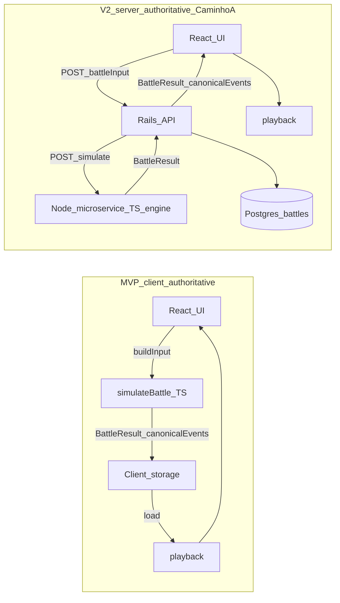
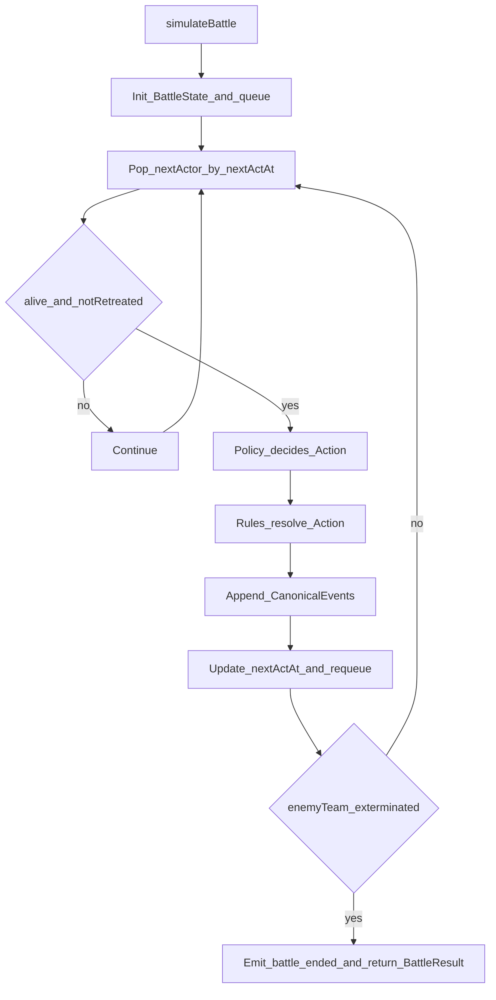

# ADR: combat engine v1 (auto-battler) with canonical event log playback

**Status:** Accepted  
**Date:** 2026-05-07  
**Context:** combat refactors (`src/domain/autobattle/*`), encounter combat (`encounterCombatRound`), future auto-battler on hex grid.

## Context

Queremos evoluir para um **auto-battler hands-off and chill** (tick + initiative bar), com:

- Battlefield em **hex grid** (inicialmente “soft”, evoluindo para posicionamento real).
- **Buildcrafting pesado** (loadouts, scaling, sinergias, procs, atributos).
- Movimento automático (raro no frontline), **colisão 1 unidade por tile**, obstacles.
- Melee = **hex adjacente**, ranged = **alcance** (sem LoS no MVP).
- **Retreat** como mecânica para evitar morte, com chance de **permadeath**.
- Vitória: exterminar time inimigo.

Ao mesmo tempo, o MVP precisa iterar rápido (single player no client). Na v2, queremos tornar a simulação **server-authoritative** (backend em Rails API mode), sem reescrever o motor.

Por fim, decidimos que “replay” significa **playback**, no estilo “a batalha aconteceu uma vez; o replay só toca o que aconteceu”, e não re-simulação determinística.

## Decision

### Performance target (non-goal for MVP)

- Motor não precisa ser “sub-50ms”. **Até ~200ms por batalha** é aceitável no MVP.
- O design deve suportar crescer para **combates grandiosos** no futuro (eventualmente **~200 unidades**), mas sem otimizar prematuramente.

### 1) O motor produz um event log canônico, e replay = playback

O motor expõe uma função headless com contrato estável:

- `simulateBattle(input) -> BattleResult`
- `BattleResult.canonicalEvents` é a fonte de verdade visual e lógica para replay/UI.
- Replay **não** roda o motor novamente; apenas executa `playback(canonicalEvents)` para reconstruir o estado ao longo do tempo.

**Implicação:** mudanças futuras no RNG/regras do motor não quebram replays gravados, desde que `canonicalEvents` continue migrável.

### 2) Aleatoriedade não é seedada (MVP), mas o resultado sempre é gravado no log

- O motor usa `Math.random()` sem seed por padrão.
- O log grava **resultados finais** (ex.: dano final, flags de dodge/block/crit, status aplicado), não “rolagens”.
- Assim, o playback não depende de RNG.

### 3) `canonicalEvents` é versionado e migrável

Todo `BattleResult` carrega `schemaVersion`. O replayer executa migrations quando necessário:

- `migrate(event, fromVersion, toVersion) -> event'`

### 4) O motor é um módulo headless com boundaries rígidos

Dentro de `src/domain/combat/**`:

- **Proibido**: React/DOM (`window`, `document`), storage (`localStorage`/IndexedDB), rede (`fetch`), timers reais (`setTimeout`/`setInterval`), e uso de wallclock (`Date.now()`) para lógica.
- **Permitido**: `Math.random()` e funções puras do domínio (`src/domain/autobattle/*`).

**Objetivo:** permitir mover a execução do motor para outro runtime (microservice Node) sem reescrita.

### 5) Estratégia de runtime por fase

- **MVP (client-authoritative, single player):**
  - Client executa `simulateBattle(input)`.
  - Client persiste `BattleResult` localmente (adapter fora do motor).
  - UI faz playback do log.
- **v2 (server-authoritative, Rails + Caminho A):**
  - Rails chama um microservice Node que executa o mesmo motor TypeScript e devolve `BattleResult`.
  - Rails persiste `BattleResult` no banco.
  - Client recebe `canonicalEvents` do server e faz somente playback.

## Diagrams

### Runtime and ownership (MVP → v2)



### Tick/initiative loop (engine core)



## Module map (engine layout)

Esta seção descreve a organização proposta do motor como módulos pequenos e “plugáveis”. A meta é evitar o tipo de acoplamento que hoje deixa loops como `runEncounterCombatRound` crescerem demais.

### Top-level overview

- `src/domain/combat/core/`
  - **Responsabilidade**: loop de simulação, initiative queue, invariantes do estado, emissão do event log canônico.
  - **Não deve conter**: regras específicas de skill/dano/targeting além de chamar `policy` + `rules`.
- `src/domain/combat/rules/`
  - **Responsabilidade**: “resolver” ações e efeitos (damage/heal/status/movement/retreat) como funções puras.
  - **Reuso**: reutiliza as funções já existentes em `src/domain/autobattle/*` (ver abaixo).
- `src/domain/combat/ai/`
  - **Responsabilidade**: decidir a próxima ação no modo hands-off (policy/autoplay).
  - **Reuso**: aproveitar `pickAutoplaySkill` / `scoreSkillTemplate` como base.
- `src/domain/combat/grid/`
  - **Responsabilidade**: adapter/port para hex grid (`IHexGrid`) e lógica de ocupação.
  - **Nota**: é aqui que `honeycomb-grid` entraria no futuro, sem contaminar o core.
- `src/domain/combat/io/`
  - **Responsabilidade**: playback do log canônico, migração de schema, geração de combat text, e stats derivadas do log.
  - **Importante**: playback não roda o core.

### Suggested module list (paths)

- `src/domain/combat/core/`
  - `simulate.ts` — entrypoint único: `simulateBattle(input) -> BattleResult`
  - `battleState.ts` — tipos `BattleState`, `UnitState`, `TeamState`, `TileId`, etc.
  - `initiative.ts` — priority queue por `nextActAt` com tie-break estável
  - `tick.ts` — loop que consome a queue e chama `policy` + `rules`
  - `events.ts` — tipos `CanonicalEvent` + helpers para append/ids
  - `randomSource.ts` — wrapper mínimo (default `Math.random`)

- `src/domain/combat/rules/`
  - `resolveAction.ts` — dispatcher `Action -> events + state changes`
  - `damageRules.ts` — pipeline de dano (reuso de `resolveStrikeDamage`)
  - `powerRules.ts` — cálculo de power (reuso de `computeRawPower`)
  - `movementRules.ts` — step/path “soft” e ocupação
  - `targetingRules.ts` — achar alvos (adjacente/range)
  - `statusRules.ts` — apply/expire/decay
  - `retreatRules.ts` — decisão/execução de retreat + permadeath roll (resultado final no event)

- `src/domain/combat/ai/`
  - `policy.ts` — `decideAction(state, actorId) -> Action`
  - `skillPolicy.ts` — escolha de skill disponível (mana/cooldown/range)

- `src/domain/combat/grid/`
  - `IHexGrid.ts` — port/interface
  - `softHexGrid.ts` — adapter inicial usando `src/domain/hex.ts`
  - `honeycombHexGrid.ts` — adapter futuro (quando adotarem `honeycomb-grid`)

- `src/domain/combat/io/`
  - `playback.ts` — `playback(events) -> timeline/snapshots`
  - `eventSchema.ts` — `schemaVersion`, migrations, guards
  - `combatLog.ts` — `events -> string[]` (narrativa)
  - `statsSummary.ts` — `events -> summary`

### How `src/domain/autobattle/*` is reused (no rewrite)

O motor novo não descarta o que já existe — ele o “encaixa” como rules/utilities:

- `src/domain/autobattle/damageResolution.ts`
  - **Usado por**: `src/domain/combat/rules/damageRules.ts`
  - **Papel**: unificar mitigation (dodge/block) e, no futuro, resistências por `MoveDamageKind`.
- `src/domain/autobattle/movePower.ts`
  - **Usado por**: `src/domain/combat/rules/powerRules.ts`
  - **Papel**: transformar `MoveTemplate.power` + atributos em magnitude integer de efeito.
- `src/domain/autobattle/autoplayStrike.ts`
  - **Usado por**: `src/domain/combat/rules/resolveAction.ts` (quando `Action.kind === 'cast'`)
  - **Papel**: resolver “cast ofensivo” a partir do template e atributos (gera `damage_dealt`).
- `src/domain/autobattle/skillPick.ts`
  - **Usado por**: `src/domain/combat/ai/skillPolicy.ts`
  - **Papel**: scoring/pick de skills baseado em tags/beat; o policy só adiciona filtros (mana/cooldown/range).

Esse split mantém o `autobattle` como uma mini-API de combate (math/pick), enquanto o novo `combat/core` cuida de **tempo (ticks)**, **posicionamento/ocupação** e **event log**.

## Contracts (types and interfaces)

Esta seção define os contratos formais do motor. O objetivo é que:

- O motor seja chamável tanto no **client** quanto no **Node microservice** (v2).
- O **event log canônico** seja a API externa principal (UI, replay, stats).
- As dependências (grid, policy, content catalogs) sejam injetadas por interfaces.

### Identifiers and coordinates

```ts
export type SchemaVersion = number;

export type BattleId = string;
export type UnitId = string;
export type TeamId = string;
export type SkillId = string; // MoveTemplateId in existing code
export type StatusId = string;

// Axial coordinate encoded as a stable string key: "q,r" (no spaces).
export type TileId = string;

export interface AxialCoord {
  q: number;
  r: number;
}
```

### Engine input / output

```ts
export interface BattleInput {
  battleId: BattleId;

  // Content access (existing catalog fits here: getMoveTemplate).
  getSkillTemplate: (id: SkillId) => unknown | undefined;

  // Battlefield and occupancy.
  grid: IHexGrid;
  obstacles: ReadonlySet<TileId>;

  // Teams + initial units.
  teams: readonly { teamId: TeamId; label?: string }[];
  units: readonly UnitSpec[];

  // Simulation options (tuning knobs).
  maxTicks: number; // hard stop to prevent infinite sims
  startTick?: number; // default 0
}

export interface BattleResult {
  schemaVersion: SchemaVersion;
  battleId: BattleId;

  // Canonical log that drives UI + replay + stats.
  canonicalEvents: readonly CanonicalEvent[];

  // Final state for quick read; must match playback(end).
  finalState: BattleStateSummary;

  // Aggregates derived either during sim or post-processed from events.
  summary: BattleStatsSummary;
}
```

### Unit spec and runtime state

```ts
export type UnitRole = 'frontline' | 'ranged' | 'support';

export interface UnitSpec {
  unitId: UnitId;
  teamId: TeamId;
  role: UnitRole;

  tileId: TileId;

  // Attributes are intentionally generic; existing CoreAttributes can fit here.
  attributes: Record<string, number>;

  maxHp: number;
  hp?: number; // default maxHp

  maxMana: number;
  mana?: number; // default 0

  // Loadout (MoveTemplateId list).
  skillIds: readonly SkillId[];

  // Initiative model.
  speed: number;
}

export interface UnitState {
  unitId: UnitId;
  teamId: TeamId;
  role: UnitRole;

  tileId: TileId;

  attributes: Record<string, number>;

  hp: number;
  maxHp: number;

  mana: number;
  maxMana: number;

  skillIds: readonly SkillId[];

  cooldowns: Record<SkillId, number>;
  statuses: Record<StatusId, number>; // remaining turns/ticks (unit-defined)

  nextActAt: number;

  retreated: boolean;
  alive: boolean;
}

export interface BattleState {
  tick: number;

  // Canonical state is map-like for O(1) lookup.
  unitsById: Record<UnitId, UnitState>;

  // Queue is stored in a dedicated structure (min-heap).
  initiativeQueue: unknown;

  // Strictly for sim; UI/replay reads events instead.
  eventIndex: number;
}

export interface BattleStateSummary {
  winningTeamId: TeamId | null;
  ticksElapsed: number;
  livingUnitsByTeam: Record<TeamId, number>;
}
```

### Actions (internal decision contract)

Actions são internas ao motor (policy → rules). Elas não precisam ser persistidas para replay, porque o replay reproduz os **resultados** via `CanonicalEvent`.

```ts
export type Action =
  | { kind: 'wait' }
  | { kind: 'attack'; targetId: UnitId }
  | { kind: 'cast'; skillId: SkillId; targetId?: UnitId; targetTileId?: TileId }
  | { kind: 'move'; toTileId: TileId }
  | { kind: 'retreat'; reason: string };
```

### Canonical event log (external contract)

```ts
export type CanonicalEvent =
  | { t: number; eventIndex: number; type: 'tick_advanced' }
  | {
      t: number;
      eventIndex: number;
      type: 'unit_spawned';
      unitId: UnitId;
      teamId: TeamId;
      role: UnitRole;
      tileId: TileId;
      hp: number;
      maxHp: number;
      mana: number;
      maxMana: number;
    }
  | {
      t: number;
      eventIndex: number;
      type: 'unit_moved';
      unitId: UnitId;
      fromTileId: TileId;
      toTileId: TileId;
    }
  | {
      t: number;
      eventIndex: number;
      type: 'unit_acted';
      unitId: UnitId;
      action: 'attack' | 'cast' | 'retreat' | 'wait' | 'move';
      targetId?: UnitId;
      skillId?: SkillId;
    }
  | {
      t: number;
      eventIndex: number;
      type: 'damage_dealt';
      sourceId: UnitId;
      targetId: UnitId;
      amount: number;
      damageKind: string;
      flags: { dodged?: boolean; blocked?: boolean; crit?: boolean };
    }
  | {
      t: number;
      eventIndex: number;
      type: 'healed';
      sourceId: UnitId;
      targetId: UnitId;
      amount: number;
    }
  | {
      t: number;
      eventIndex: number;
      type: 'status_applied';
      sourceId: UnitId;
      targetId: UnitId;
      statusId: StatusId;
      turns?: number;
    }
  | {
      t: number;
      eventIndex: number;
      type: 'status_expired';
      targetId: UnitId;
      statusId: StatusId;
    }
  | {
      t: number;
      eventIndex: number;
      type: 'unit_retreated';
      unitId: UnitId;
      reason: string;
    }
  | {
      t: number;
      eventIndex: number;
      type: 'unit_died';
      unitId: UnitId;
      sourceId?: UnitId;
      permadeath: boolean;
    }
  | {
      t: number;
      eventIndex: number;
      type: 'battle_ended';
      winningTeamId: TeamId;
    };
```

### Hex grid port (engine dependency)

O motor não depende de `honeycomb-grid` diretamente. Ele depende desta interface:

```ts
export interface IHexGrid {
  // Convert between string key and axial coords.
  parseTileId(tileId: TileId): AxialCoord | null;
  tileIdFromAxial(coord: AxialCoord): TileId;

  neighbors(tileId: TileId): readonly TileId[];
  distance(a: TileId, b: TileId): number;

  // Engine-level queries with obstacles + unit occupancy.
  isBlocked(tileId: TileId, params: { obstacles: ReadonlySet<TileId>; occupied: ReadonlySet<TileId> }): boolean;

  // Optional helpers (future): reachable tiles / pathing / rings.
  reachable?(
    from: TileId,
    params: {
      maxSteps: number;
      obstacles: ReadonlySet<TileId>;
      occupied: ReadonlySet<TileId>;
    },
  ): readonly TileId[];
}
```

### Why these contracts look “generic” on purpose

- `attributes: Record<string, number>` permite encaixar `CoreAttributes` sem travar o motor cedo.
- `getSkillTemplate` é genérico para não duplicar `MoveTemplate` aqui; o motor pode importar diretamente `MoveTemplate` mais tarde quando estabilizar.
- `CanonicalEvent` é **resultado final** para playback; se no futuro quiserem “input log”, ele vira um stream separado.

## Canonical event schema (v1)

### Princípios

- **Ordem total:** eventos são ordenados por `(t asc, eventIndex asc)`.
- **IDs estáveis:** referenciar sempre `unitId`, `skillId`, `tileId` (ex.: axial `q,r`), nunca ponteiros/objetos.
- **Resultados finais:** o evento carrega resultado final suficiente para playback (sem RNG).
- **Semântica:** eventos descrevem “o que aconteceu”, não “o que foi tentado”.

### Campos obrigatórios (todas as variantes)

- `schemaVersion: number` (no `BattleResult`)
- `battleId: string` (gerado fora do motor, ou pelo chamador)
- `t: number` (tick lógico)
- `eventIndex: number` (monotônico dentro da batalha)
- `type: CanonicalEventType`
- `actorId?: string` (quando aplicável)

### Tipos mínimos de eventos

- `tick_advanced { t }`
- `unit_spawned { unitId, teamId, role, tileId, hp, maxHp, mana, maxMana }`
- `unit_moved { unitId, fromTileId, toTileId }`
- `unit_acted { unitId, action: 'attack'|'cast'|'retreat'|'wait', targetId? , skillId? }`
- `damage_dealt { sourceId, targetId, amount, damageKind, flags: { dodged?, blocked?, crit? } }`
- `healed { sourceId, targetId, amount }`
- `status_applied { sourceId, targetId, statusId, turns? }`
- `status_expired { targetId, statusId }`
- `unit_retreated { unitId, reason }`
- `unit_died { unitId, sourceId?, permadeath: boolean }`
- `battle_ended { winningTeamId }`

## Vertical slices (roadmap with acceptance criteria)

As fatias abaixo são pensadas para entregar valor rapidamente e manter o motor evoluindo “verticalmente” (sim + log + playback) sem virar um monólito. Todas as fatias assumem:

- **Replay** via `canonicalEvents` (sempre gravar o suficiente para playback).
- **Escala-alvo**: começar com 30–80 unidades, mas desenhar para **até ~200 units** no futuro.
- **Performance**: meta prática “good enough” é **≤200ms por batalha** (desktop) no MVP.

### Slice 1 — Skeleton headless + melee adjacency

- **Scope**
  - `simulateBattle(input) -> BattleResult` rodando headless.
  - Initiative queue (`nextActAt`) e loop básico.
  - Apenas `attack` melee (adjacente), sem skills, sem movement.
  - `canonicalEvents` mínimos: spawn, acted, damage, death, battle_ended.
- **Acceptance**
  - Batalha termina sempre (respeita `maxTicks`).
  - Playback do log chega no mesmo `finalState`.
- **Tests (statistical)**
  - Monte um cenário 2v2 com vantagem clara (HP/atk). Em N=200 sims, o time favorecido vence ≥80%.

### Slice 2 — Canonical event log v1 + playback tool

- **Scope**
  - Consolidar `schemaVersion=1`.
  - Implementar `playback(canonicalEvents)` (reconstrução de estado por eventos).
  - Gerar `combat text` básico a partir dos events (não a partir da sim).
- **Acceptance**
  - Para N=100 sims, `playback(...).finalState` bate com `BattleResult.finalState`.
  - `canonicalEvents` ordenado por `(t,eventIndex)` sem buracos.
- **Tests**
  - Property test simples: “nenhum evento refere unitId inexistente”.

### Slice 3 — Skills (mana + cooldown) reutilizando `src/domain/autobattle/*`

- **Scope**
  - `Action.kind='cast'` com `skillId`.
  - Mana cost e cooldowns (com decay **por tick global**, conforme decisão).
  - `resolveMoveTemplateStrike` e `resolveStrikeDamage` entram como resolver.
- **Acceptance**
  - Skill nunca castada quando `mana < cost` ou `cooldown > 0`.
  - Ao castar, emite `unit_acted{action:'cast',skillId}` + eventos de resultado (damage/heal/status).
- **Tests (statistical)**
  - Cenário com 1 skill de alto dano vs basic attack: com tuning, DPS médio aumenta dentro de um intervalo esperado (ex.: +20–60%) em N=200.

### Slice 4 — Targeting (melee adjacency + ranged range) + obstacles read

- **Scope**
  - Melee precisa de adjacency; se não está adjacente, tenta “aproximar” (ainda sem path complexo).
  - Ranged respeita `range` e não precisa adjacency.
  - Obstacles entram em `isBlocked` para impedir stepping em tiles.
- **Acceptance**
  - Nenhum `unit_moved` entra em tile bloqueado/ocupado.
  - Ranged não faz `attack/cast` fora do range.
- **Tests**
  - Cenário com obstacle entre times: melee contorna/para (dependendo da regra), mas nunca atravessa tile blocked.

### Slice 5 — Movement “soft” (greedy step) + occupancy (1 unit/tile)

- **Scope**
  - `Action.kind='move'` e emissão de `unit_moved`.
  - Movement é “raro”, mas existe como mecanismo para encostar (melee) ou kite (ranged futuro).
  - Tie-break estável ao escolher neighbor (ordem determinística por TileId).
- **Acceptance**
  - Unidades nunca colidem; `occupied` é respeitado.
  - Movement não entra em loop infinito (ex.: oscillation); se travar, faz `wait`.
- **Tests (statistical)**
  - Em mapas aleatórios pequenos com obstacles, sim não trava (N=200, cada sim com maxTicks).

### Slice 6 — Retreat + permadeath outcome in log

- **Scope**
  - Policy pode emitir `Action.kind='retreat'` em threshold de HP.
  - Resolver gera `unit_retreated` e, quando aplicável, `unit_died{permadeath:true|false}`.
  - Resultado do roll sempre vai no event (playback não rola nada).
- **Acceptance**
  - Um unit retreated não age mais nem é alvo.
  - Permadeath nunca é calculada no playback (somente reproduz o resultado).
- **Tests (statistical)**
  - Em N=500, taxa de retreat/permadeath cai em um range esperado configurável (ex.: retreat 5–30%, permadeath 0.5–10% dependendo de tuning).

### Slice 7 — Auto-placement by role (frontline/ranged/support)

- **Scope**
  - A partir de “meu personagem é frontline”, motor escolhe tiles iniciais.
  - Regras simples: frontline mais perto do anchor, ranged atrás, support mais atrás.
- **Acceptance**
  - Tiles iniciais são sempre válidos (não bloqueados, sem colisão) ou o motor falha com erro claro.
  - Emite `unit_spawned` com `tileId` final escolhido.

### Slice 8 — AoE shapes and clusters (optional early)

- **Scope**
  - `targets: multi/all` do `MoveTemplate` (já existe em `src/domain/types/combat.ts`) vira targeting real no grid.
  - “Cluster” simples: escolhe alvo primário e pega N vizinhos.
- **Acceptance**
  - Eventos de dano são emitidos por alvo atingido (granular).

### Slice 9 — Scale pass (toward 200 units)

- **Scope**
  - Profiling básico e ajustes de dados (evitar `O(n^2)` fácil).
  - Estruturas mais eficientes: `unitsByTeam`, sets de occupied, caches de neighbors.
- **Acceptance**
  - Cenário de stress com 200 unidades conclui em ≤200ms (desktop dev) para uma batalha curta “benchmark” (definir input fixo).

### Slice 10 — v2 wiring (Caminho A: Rails → Node microservice)

- **Scope**
  - Motor TS roda em um serviço Node (`POST /simulate`) e retorna `BattleResult`.
  - Rails chama, valida, persiste e serve o log.
- **Acceptance**
  - Client recebe `BattleResult` do server e toca o replay sem rodar sim.

## Migration strategy (no long coexistence)

- Não planejamos manter dois motores de combate suportados em paralelo.
- A intenção é **migrar totalmente** para a nova engine assim que ela cobrir o produto.
- O “path de migração” relevante dentro do motor é o **adapter de grid** (`softHexGrid` → `honeycombHexGrid`) e a troca de **caller** na v2 (client → Rails→Node microservice). O core e o schema do event log permanecem.

## Consequences

**Positive**

- Replay é robusto e barato: playback puro do log.
- MVP no client mantém alta velocidade de iteração.
- v2 server-authoritative não exige reescrita do motor: só muda o “caller”.
- O motor pode evoluir sem quebrar replays se o schema for versionado e migrável.

**Trade-offs / follow-ups**

- Logs podem ficar grandes; considerar snapshots periódicos (opcional) para seek/fast-forward no UI.
- Testes “estatísticos” podem flakear; mitigar com N alto e bounds folgados. Para testes pontuais exatos, permitir injeção de `randomSource` fake apenas nesses testes.
- Necessário manter disciplina de boundary (sem IO no motor), idealmente com regras de lint.

## References (code)

| Area | Location |
| --- | --- |
| Autoplay pick / strike / damage math (reuso) | `src/domain/autobattle/index.ts` |
| Strike + mitigation pipeline | `src/domain/autobattle/damageResolution.ts` |
| Template power scaling | `src/domain/autobattle/movePower.ts` |
| Move catalog | `src/content/catalogs/moves.ts` |
| Combat types (MoveTemplate, tags, kinds) | `src/domain/types/combat.ts` |
| Current encounter combat loop (legado) | `src/domain/encounterCombatRound.ts` |

